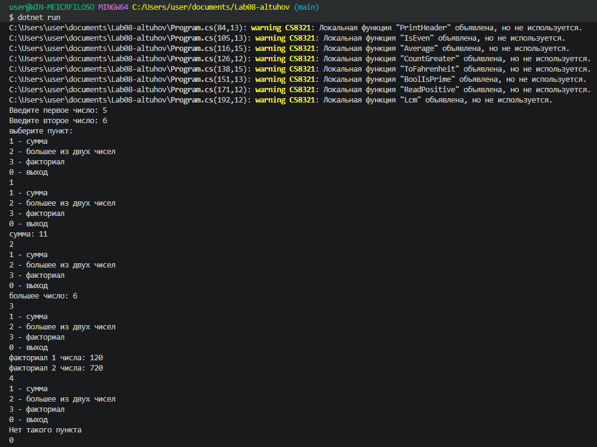
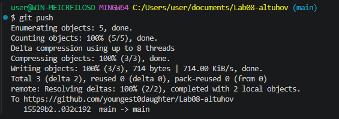

# Практическая работа №8

**ФИО:** Алитухов Павел
**Группа:** ИСП -241
**Дата:** 20.11.2026  

## Что изучено
- Научился объявлять собственные методы и вызывать их в коде, передавая нужные данные через параметры.
- Разобрался в разнице между методами `void` и методами с типом возвращаемого значения, использующими оператор `return`.
- Освоил вынос повторяющихся блоков кода в отдельные методы, что делает программу короче, понятнее и проще для исправления ошибок.

